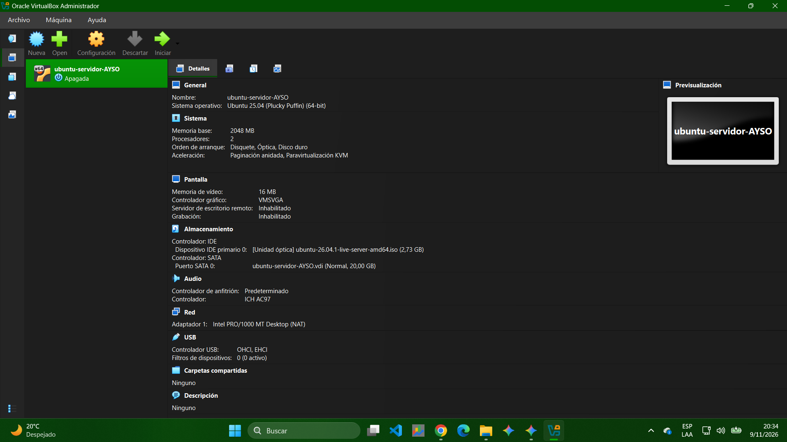
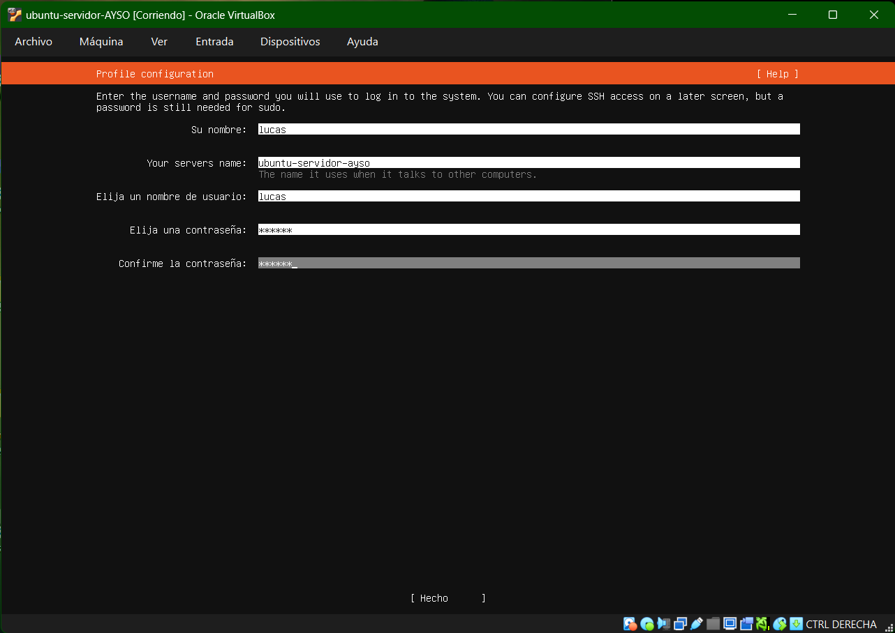
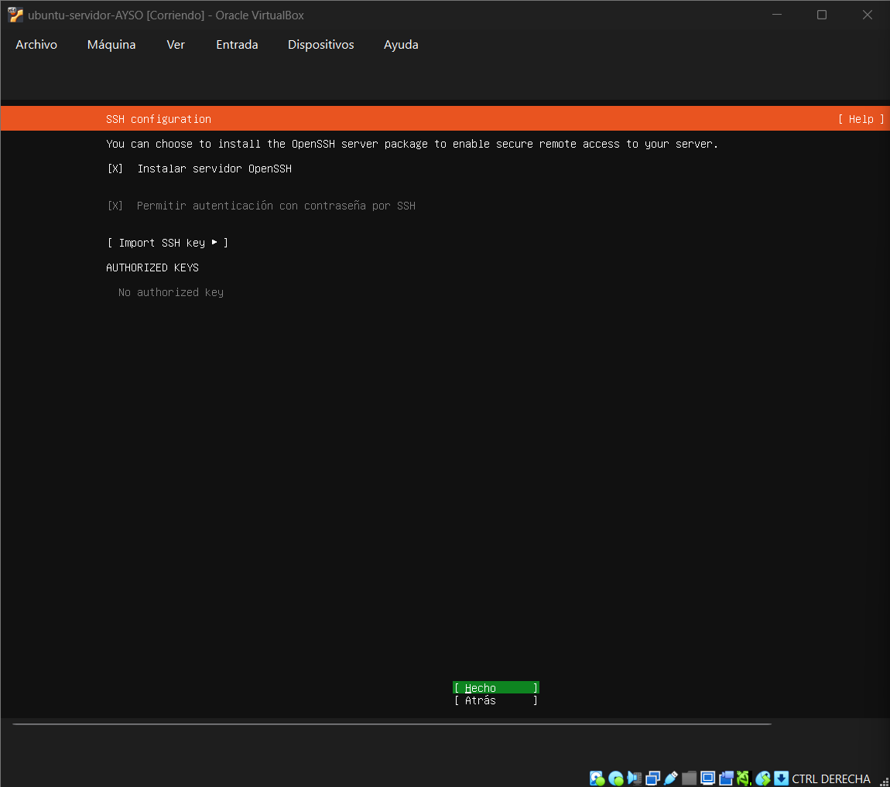
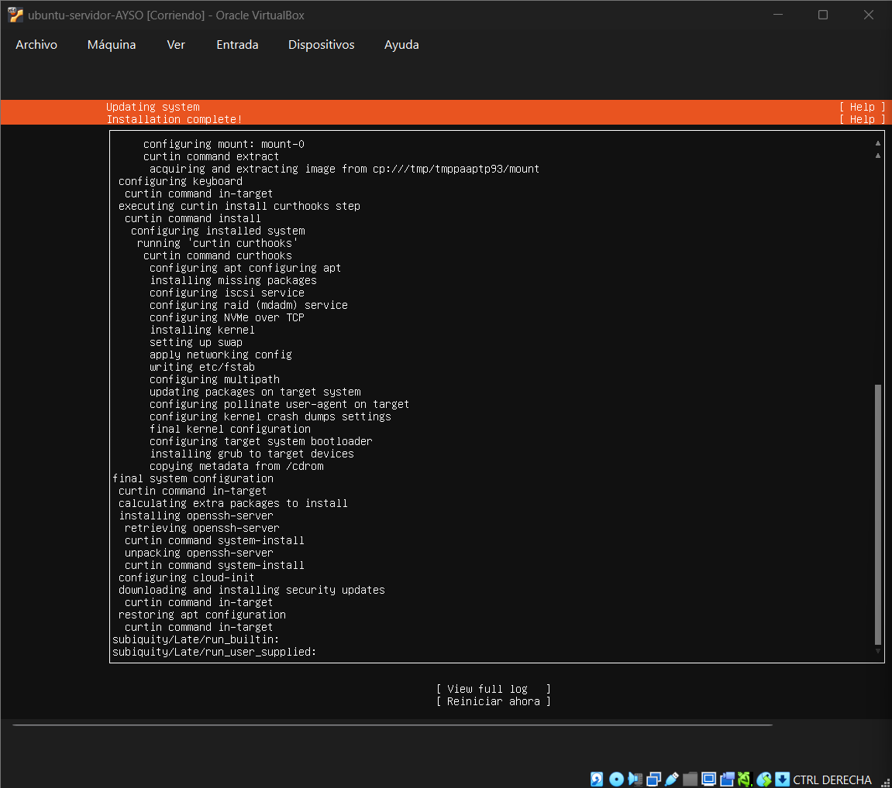
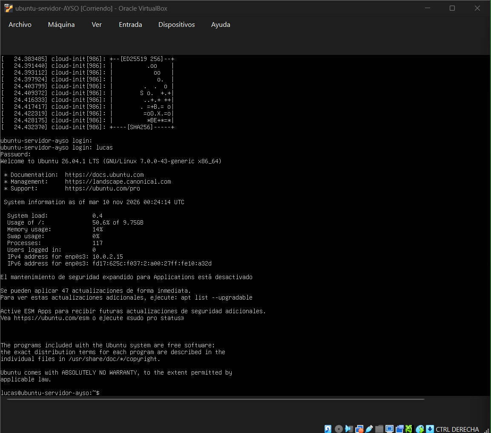
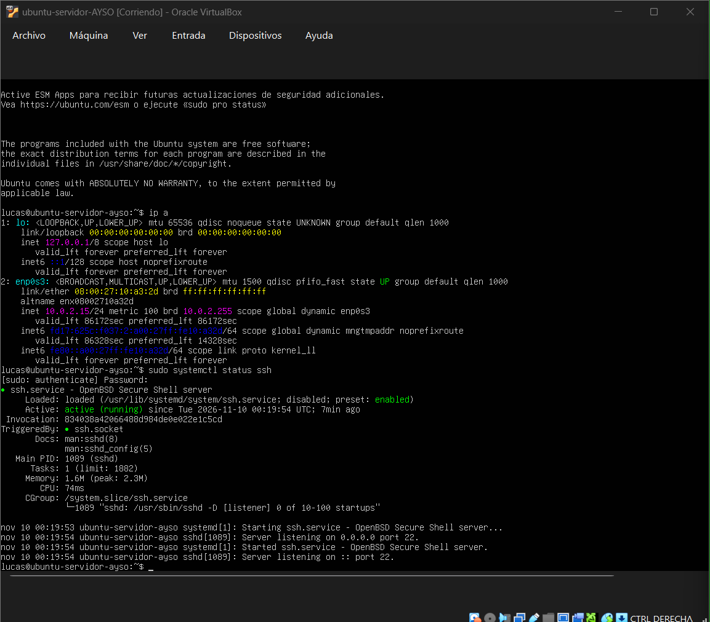

# Trabajo Integrador: Virtualización y Computación en la Nube
**Materia:** Arquitectura y Sistemas Operativos  
**Carrera:** Tecnicatura Universitaria en Programación a Distancia (TUPaD) - UTN  
**Año:** 2026  

---

## 1. Descripción del Proyecto
Este proyecto aborda la investigación e implementación práctica de tecnologías de virtualización. Se analiza el rol de los hipervisores (Tipo 1 y Tipo 2), el aprovisionamiento de recursos computacionales (vCPU, vRAM, almacenamiento dinámico y redes virtuales) y su relación directa con los modelos de infraestructura en la nube (IaaS).

---

## 2. Marco Teórico y Fuentes Técnicas
* **Virtualización:** Abstracción de recursos físicos de cómputo para permitir la ejecución de múltiples sistemas operativos de manera simultánea y aislada.
* **Hipervisores:**
  * **Tipo 1 (Bare-Metal):** Ejecución directa sobre hardware (VMware ESXi, Proxmox VE, KVM).
  * **Tipo 2 (Hosted):** Ejecución como aplicación sobre sistema operativo anfitrión (Oracle VirtualBox, VMware Workstation).
* **Ejemplo Cloud (IaaS):** Modelos elásticos como AWS EC2 o Azure Virtual Machines, donde se asignan instancias virtuales aisladas a través de hipervisores optimizados sobre centros de datos físicos.

---

## 3. Especificaciones y Aprovisionamiento de la VM
* **Nombre de la VM:** `ubuntu-servidor-AYSO`
* **Sistema Operativo:** Ubuntu Server 26.04.1 LTS (64-bit)
* **Memoria Base (RAM):** 2048 MB (2 GB)
* **Procesadores (vCPU):** 2
* **Disco Virtual:** 20 GB (Formato VDI dinámico)
* **Red:** Modo NAT (Intel PRO/1000 MT Desktop)

---

## 4. Pruebas y Validación de Servicios
1. **Configuración de Red:**
   * `ip a` (Asignación por DHCP bajo interfaz `enp0s3` con IP `10.0.2.15/24`)
2. **Servicio de Acceso Remoto:**
   * `sudo systemctl status ssh` (Demonio OpenSSH activo en ejecución en el puerto 22)
3. **Gestión Administrativa:**
   * Usuario no-root con privilegios de superusuario (`sudo`) y autenticación habilitada.

---

## 5. Estructura del Repositorio
* `docs/`: Documento final del trabajo integrador en formato PDF.
* `capturas/`: Evidencias gráficas del aprovisionamiento, configuración y pruebas de terminal.
* `README.md`: Memoria técnica de la implementación.

---

## 6. Evidencias del Proceso de Instalación

### 6.1. Configuración de la Máquina Virtual
Aprovisionamiento de recursos de cómputo (RAM, vCPU, almacenamiento y adaptador de red NAT) en VirtualBox.

### 6.2. Configuración de Usuario y Servidor
Definición de nombre de equipo (`ubuntu-servidor-ayso`), usuario (`lucas`) y credenciales administrativas.

### 6.3. Instalación de OpenSSH Server
Habilitación del paquete OpenSSH y configuración de autenticación remota durante el despliegue.

### 6.4. Finalización del Instalador
Conclusión del particionado de disco, extracción de imagen base, kernel y gestor de arranque GRUB.

### 6.5. Primer Inicio de Sesión
Inicialización completa del sistema con `cloud-init`, generación de claves SSH de host y login interactivo por consola.

### 6.6. Verificación de Red y Estado de SSH
Salida en terminal de los comandos `ip a` (IP `10.0.2.15/24`) y `systemctl status ssh` con estado `active (running)`.

